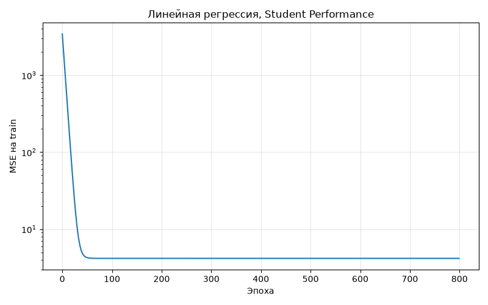
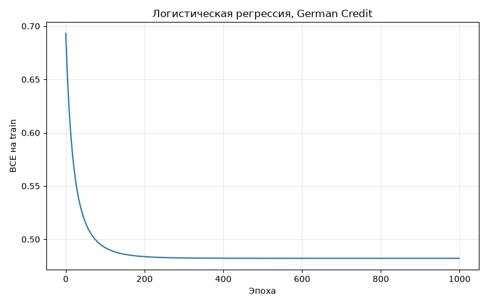

# Отчет по лабораторной работе 3

## 1. Данные и подготовка

Student Performance: 10000 строк, 5 признаков, цель Performance Index. Пропусков нет. Extracurricular Activities перевел в 1/0 (Yes/No). Разбиение 80/20, random_state=42.

German Credit: 1000 строк, 20 признаков, цель Creditability (700 хороших, 300 плохих). Пропусков нет, признаки уже числовые (коды категорий оставил как есть). Разбиение 80/20, random_state=42, со стратификацией, в тесте 140 хороших и 60 плохих.

Масштабирование: обе мои модели стандартизируют признаки по mean и std обучающей выборки, после обучения веса переводятся обратно в исходный масштаб. Для KNN и LogisticRegression из sklearn StandardScaler, дерево без масштабирования.

Обучение: пакетный градиентный спуск, веса с нуля. Регрессия lr=0.05, 800 эпох, логистическая lr=0.1, 1000 эпох, порог 0.5.

## 2. Гипотезы и эксперименты

1. Без масштабирования спуск разойдется. Да: MSE 3428 -> 9.1e8 после 1 шага -> 5.8e106 на 20 эпохе.
2. Learning rate влияет только на скорость. Да:

| lr | MSE эп. 10 | эп. 50 | эп. 800 | test MSE |
|---:|---:|---:|---:|---:|
| 0.001 | 3306.93 | 2818.45 | 144.17 | 141.12 |
| 0.01 | 2384.81 | 477.63 | 4.17 | 4.0826 |
| 0.05 | 518.79 | 4.28 | 4.17 | 4.0826 |
| 0.5 | 4.17 | 4.17 | 4.17 | 4.0826 |

3. Спуск приходит к решению МНК. Да, веса совпали с LinearRegression из sklearn до 1e-8: Hours Studied 2.85, Previous Scores 1.02, Extracurricular 0.61, Sleep 0.48, Papers 0.19, bias -33.92.
4. Моя логистическая = sklearn. Да, ROC-AUC 0.8081 против 0.8086 (у sklearn L2 регуляризация), матрицы ошибок одинаковые. BCE: 0.6931 -> 0.5165 (эп. 50) -> 0.4825 (эп. 300) -> 0.4821 (эп. 1000).
5. Дерево по умолчанию переобучится. Да, на train accuracy 1.0, на тесте ROC-AUC 0.619. GridSearchCV (5 фолдов на train, ROC-AUC) выбрал max_depth=6, min_samples_leaf=5, на тесте ROC-AUC 0.652.
6. Для KNN 5 соседей мало. Да, при k=5 ROC-AUC 0.741. GridSearchCV выбрал k=101, weights=distance.
7. Порог 0.5 не лучший. При 0.5 найдено 29 плохих из 60, при 0.6 уже 39 (accuracy 0.775). В итоге оставил 0.5 т.к. смотрел это на тесте.

Ход MSE и BCE: Figure_1.png, Figure_2.png.




## 3. Метрики

Линейная регрессия: MSE на тесте 4.0826 (RMSE 2.02, R2 0.989).

| Модель | ROC-AUC | Accuracy | Precision | Recall | F1 |
|---|---:|---:|---:|---:|---:|
| Моя логистическая | 0.8081 | 0.770 | 0.8013 | 0.8929 | 0.8446 |
| LogisticRegression | 0.8086 | 0.770 | 0.8013 | 0.8929 | 0.8446 |
| DecisionTree | 0.6520 | 0.670 | 0.7643 | 0.7643 | 0.7643 |
| KNN | 0.8362 | 0.715 | 0.7107 | 1.0000 | 0.8309 |

Найдено плохих заемщиков из 60: моя 29, дерево 27, KNN 3.

## 4. Выводы

Моя модель выигрывает по accuracy и F1 и единственная нормально находит плохих заемщиков. Дерево переобучается, данных мало. KNN с k=101 почти всех считает хорошими, accuracy 0.715 почти как у константы (0.70).

Проигрывает KNN по ROC-AUC на тесте (0.808 против 0.836), но на кросс валидации наоборот (0.7705 против 0.7631), так что скорее это случайность разбиения. Минус линейной модели: не видит нелинейности и считает коды категорий упорядоченными числами.

## 5. Воспроизводимость

Python 3.14.3, версии библиотек в uv.lock, везде random_state=42.

```
uv sync
uv run pytest
uv run python experiments.py
uv run python plot.py
```

experiments.py пишет experiment_results.json, тест test_experiment_results_reproduce сверяет его с пересчетом.
